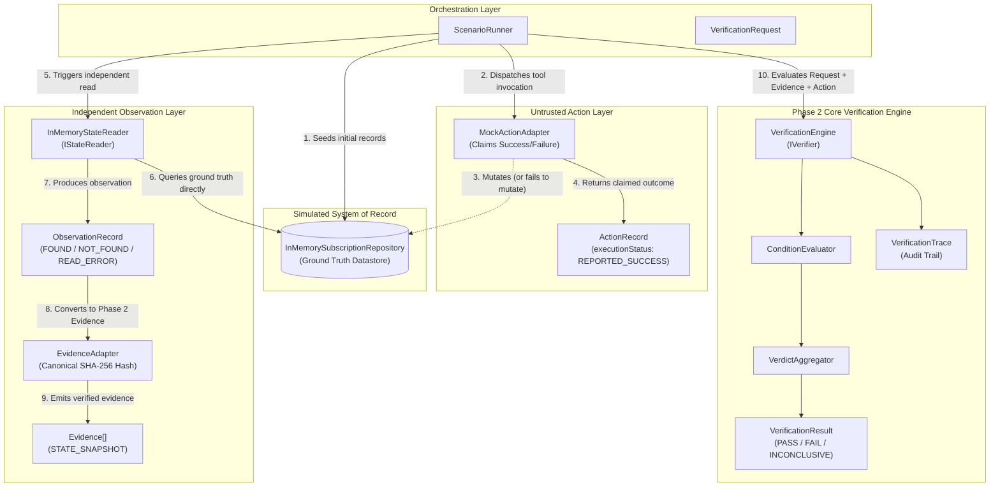

# AgentProof — Phase 3: Simulated Environment & Failure Injection

**Document Version:** 1.0.0  
**Status:** Completed & Validated  
**Author:** Senior TypeScript Architect & Software Reliability Engineer  
**Milestone:** Phase 3 (Simulated Environment & Failure Injection Harness)  

---

## 1. Purpose & Core Thesis

Phase 3 implements an in-memory, deterministic simulated environment and failure injection harness for **AgentProof**.

The primary objective of Phase 3 is to close the observational gap between claimed action execution and ground-truth state, proving the foundational thesis of AgentProof:

> **An action reporting success is not proof that the intended state change occurred.**

Phase 2 established the framework-independent deterministic core verification engine (`VerificationEngine`, `ConditionEvaluator`, `VerdictAggregator`). However, Phase 2 required caller-provided evidence arrays. Phase 3 provides the simulated system of record, an independent state observation layer, a configurable failure-injection action adapter, and a scenario runner that feeds empirical ground-truth evidence directly into the Phase 2 verification engine.

---

## 2. Architecture & Data Flow

The following Mermaid diagram illustrates the data flow, separation of concerns, and trust boundaries implemented in Phase 3:



### Trust Boundary Architecture

| Component | Trust Level | Responsibility | Authority |
| :--- | :--- | :--- | :--- |
| **Mock Action Adapter** | **Untrusted** | Executes simulated agent actions, applies mutations, and reports claimed execution status. | Claims what it *believes* or *reports* happened. **Never** authoritative. |
| **Subscription Repository** | **System of Record** | Stores the actual ground-truth subscription state in memory. Enforces revision tracking and tenant isolation. | Source of ground truth. |
| **State Reader** | **Authoritative Observer** | Reads ground truth directly without consulting or trusting the action adapter. | Authoritative for observations. |
| **Evidence Adapter** | **Provenance & Integrity** | Transforms raw observations into immutable, canonical SHA-256 hashed Phase 2 `Evidence`. | Authoritative for evidence formatting. |
| **Verification Engine** | **Verdict Authority** | Pure Phase 2 engine evaluating postconditions against evidence. | Sole authority for `PASS`, `FAIL`, and `INCONCLUSIVE` verdicts. |

---

## 3. Simulated Subscription Domain & Repository

The simulated environment models subscription management with deterministic state transitions:

### Subscription Record Schema
Located in [`src/simulation/domain/subscription.ts`](file:///c:/agentproof/agentproof/src/simulation/domain/subscription.ts):
- `subscriptionId`: Unique resource identifier (e.g., `sub-100`).
- `tenantId`: Tenant context enforcing multi-tenant isolation.
- `customerId`: Customer identifier.
- `status`: `'ACTIVE' | 'CANCELLED' | 'PAST_DUE'`.
- `plan`: Plan tier (e.g., `enterprise`, `starter`, `free`).
- `maxSeats`: Integer seat allocation.
- `features`: Array of enabled feature flags.
- `updatedAt`: ISO-8601 deterministic timestamp.
- `revision`: Non-negative integer incremented on every mutation.

### In-Memory Repository
Located in [`src/simulation/repositories/in-memory-subscription-repository.ts`](file:///c:/agentproof/agentproof/src/simulation/repositories/in-memory-subscription-repository.ts):
- **Deep-Cloning Immutability:** All reads (`getById`, `getAllByTenant`) and writes return deep clones. Callers cannot mutate internal repository state by modifying returned objects.
- **Tenant Isolation:** Enforces strict multi-tenant boundary checks. Cross-tenant reads or updates are rejected.
- **Revision & Timestamp Automation:** Every mutation automatically increments `revision` and assigns an updated timestamp from an injectable `IClock`.
- **Deterministic Clocks:** Integrates with `DeterministicClock` to ensure zero dependency on system real time.

---

## 4. Failure-Injection Model

Located in [`src/simulation/failure-injection/failure-mode.ts`](file:///c:/agentproof/agentproof/src/simulation/failure-injection/failure-mode.ts).

The mock action adapter supports five explicit, typed execution modes:

```typescript
export type FailureMode =
  | 'GENUINE_SUCCESS'
  | 'FALSE_SUCCESS'
  | 'WRONG_TARGET'
  | 'PARTIAL_UPDATE'
  | 'GENUINE_FAILURE';
```

### 1. `GENUINE_SUCCESS`
- **Behavior:** The adapter mutates the intended target record in the repository and reports `REPORTED_SUCCESS`.
- **Ground Truth:** State changes to the requested values (e.g., `status: 'CANCELLED'`).
- **Independent Observation:** Confirms the mutation.
- **Expected Verdict:** `PASS` (assuming all required conditions are satisfied).

### 2. `FALSE_SUCCESS` (Primary Demonstration)
- **Behavior:** The adapter reports `REPORTED_SUCCESS`, but **performs no mutation** on ground truth.
- **Ground Truth:** State remains completely unchanged (e.g., `status: 'ACTIVE'`).
- **Independent Observation:** Detects unchanged state (`status: 'ACTIVE'`).
- **Expected Verdict:** `FAIL` (`FAIL_VALUE_MISMATCH`). Proves that action claims do not dictate truth.

### 3. `WRONG_TARGET`
- **Behavior:** The adapter mutates an unintended subscription (`wrongTargetSubscriptionId`) while reporting success for the requested target.
- **Ground Truth:** Intended target remains unchanged; alternate target is mutated.
- **Independent Observation:** Evaluates the intended target specified in the `VerificationRequest`.
- **Expected Verdict:** `FAIL` (`FAIL_VALUE_MISMATCH`) for the intended target. Evidence regarding unintended resources cannot falsely pass the requested target.

### 4. `PARTIAL_UPDATE`
- **Behavior:** The adapter applies only a configured subset of mutations (`partialFields`), omitting other required updates.
- **Ground Truth:** Some attributes change (e.g., `plan: 'free'`), while others remain unchanged (e.g., `status: 'ACTIVE'`).
- **Independent Observation:** Captures the partial state.
- **Expected Verdict:** `FAIL` when any required condition is unsatisfied.

### 5. `GENUINE_FAILURE`
- **Behavior:** The adapter encounters an operational failure and reports `REPORTED_FAILURE`.
- **Ground Truth:** No state changes occur.

---

## 5. Independent State Reader & Evidence Adapter

### State Reader (`InMemoryStateReader`)
Located in [`src/simulation/observation/in-memory-state-reader.ts`](file:///c:/agentproof/agentproof/src/simulation/observation/in-memory-state-reader.ts):
- Queries `ISubscriptionRepository` directly using `target.tenantId` and `target.resourceId`.
- Completely oblivious to the action adapter's claims.
- Returns explicit `ObservationRecord` with status:
  - `FOUND`: Target exists in ground truth; cloned record payload returned.
  - `NOT_FOUND`: Target confirmed absent from system of record; payload is `null`.
  - `READ_ERROR`: Observation infrastructure failed (e.g., timeout, datastore offline).
- Supports controlled fault simulation via `setSimulatedError(predicate)`.

### Evidence Adapter (`EvidenceAdapter`)
Located in [`src/simulation/observation/evidence-adapter.ts`](file:///c:/agentproof/agentproof/src/simulation/observation/evidence-adapter.ts):
- Converts `ObservationRecord` into Phase 2 compliant `Evidence` objects.
- **Canonical SHA-256 Hashing:** Recursively sorts object keys to guarantee deterministic integrity hashes invariant to JSON key order.
- **Anti-Fabrication Policy:** When an observation has status `READ_ERROR`, `toEvidence()` returns `null`. It never fabricates empty records or assumes state.
- **Missing Resource Handling:** For `NOT_FOUND` observations, it emits evidence with `observedPayload: null` and limitation tag `RESOURCE_NOT_FOUND_IN_SYSTEM_OF_RECORD`.

---

## 6. Demonstration Scenarios (Scenarios A through H)

Located in [`src/simulation/scenarios/scenarios.ts`](file:///c:/agentproof/agentproof/src/simulation/scenarios/scenarios.ts) and orchestrated by [`src/simulation/scenarios/scenario-runner.ts`](file:///c:/agentproof/agentproof/src/simulation/scenarios/scenario-runner.ts).

| Scenario | Scenario Name | Injected Mode | Reported Action | Ground Truth State | Observed Evidence | Expected Verdict | Reason Code |
| :--- | :--- | :--- | :--- | :--- | :--- | :--- | :--- |
| **A** | Genuine Success | `GENUINE_SUCCESS` | `REPORTED_SUCCESS` | `ACTIVE` → `CANCELLED` | `status: 'CANCELLED'` | **`PASS`** | `PASS_ALL_CONDITIONS_VERIFIED` |
| **B** | False Success | `FALSE_SUCCESS` | `REPORTED_SUCCESS` | `ACTIVE` → `ACTIVE` | `status: 'ACTIVE'` | **`FAIL`** | `FAIL_VALUE_MISMATCH` |
| **C** | Wrong Target Mutation | `WRONG_TARGET` | `REPORTED_SUCCESS` | A: `ACTIVE`, B: `CANCELLED` | A: `status: 'ACTIVE'` | **`FAIL`** | `FAIL_VALUE_MISMATCH` |
| **D** | Partial Update | `PARTIAL_UPDATE` | `REPORTED_SUCCESS` | `status: 'ACTIVE'`, `plan: 'free'` | `status: 'ACTIVE'`, `plan: 'free'` | **`FAIL`** | `FAIL_VALUE_MISMATCH` |
| **E** | Missing Target | `FALSE_SUCCESS` | `REPORTED_SUCCESS` | Record absent | `observedPayload: null` | **`INCONCLUSIVE`** | `INC_MISSING_ATTRIBUTES` |
| **F** | Observation Unavailable | `GENUINE_SUCCESS` | `REPORTED_SUCCESS` | `ACTIVE` → `CANCELLED` | 0 evidence items (read error) | **`INCONCLUSIVE`** | `INC_EVIDENCE_NOT_FOUND` |
| **G** | Tenant Isolation | `GENUINE_SUCCESS` | `REPORTED_SUCCESS` | Alpha: `CANCELLED`, Beta: `ACTIVE` | Alpha: `CANCELLED` | **`PASS`** | `PASS_ALL_CONDITIONS_VERIFIED` |
| **H** | Multiple Required Conditions | `GENUINE_SUCCESS` | `REPORTED_SUCCESS` | `status: 'CANCELLED'`, `plan: 'enterprise'` | `status: 'CANCELLED'`, `plan: 'enterprise'` | **`FAIL`** | `FAIL_VALUE_MISMATCH` |

---

## 7. How to Run Tests and Demonstrations

All commands must be executed from the application directory (`C:\agentproof\agentproof`):

### 1. Run Complete Automated Test Suite
```bash
npm test
```
Executes all 13 test files (80 passing tests), including Phase 1 foundation tests, Phase 2 core verification tests, and all Phase 3 simulation tests.

### 2. Run Standalone Demonstration Script
```bash
npm run demo
```
Compiles TypeScript and runs [`src/simulation/demo.ts`](file:///c:/agentproof/agentproof/src/simulation/demo.ts), which prints an evidence-backed verification matrix for Scenarios A through H directly to the console.

### 3. Build Production Bundle
```bash
npm run build
```
Compiles all TypeScript files under `src/` to `dist/` with strict type-checking.

---

## 8. Current Limitations & Scope Boundaries

1. **In-Memory System of Record:** The subscription repository operates entirely in memory using JavaScript `Map` collections. It is not connected to PostgreSQL, MySQL, Redis, or external cloud databases.
2. **Deterministic Mock Adapter:** The action adapter simulates tool execution deterministically. It does not interface with third-party billing providers (e.g., Stripe, Recurly, Chargebee).
3. **No MCP Server Registration:** Phase 3 implements the simulation domain and test harness. Business-level MCP tools (`verify_outcome`, `inspect_trace`, `list_scenarios`, `run_scenario`) are deferred to Phase 4.
4. **No LLM or Probabilistic Evaluation:** Verification remains 100% deterministic, predicate-driven, and evidence-backed.

---

## 9. Next Steps: Phase 4

With Phase 3 complete and validated:
- **Phase 4 (MCP Protocol Integration & Controllers):** Register official NitroStack MCP tools (`verify_outcome`, `inspect_trace`, `run_scenario`), expose verification endpoints to AI agent clients, and format verification results according to MCP specifications.
