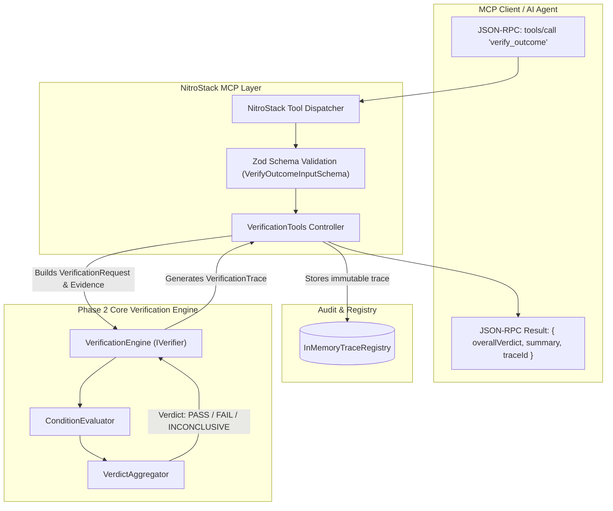
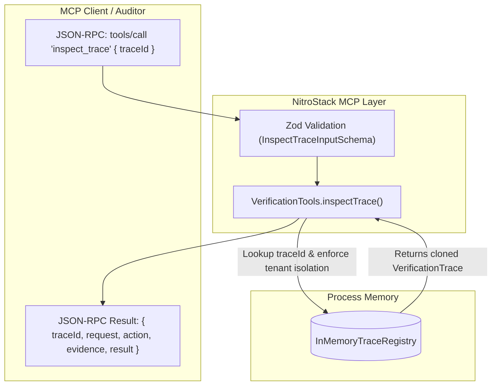

# AgentProof — Phase 4: NitroStack MCP Protocol Integration

**Document Version:** 1.0.0  
**Status:** Completed & Validated  
**Author:** Senior TypeScript Architect & Software Reliability Engineer  
**Milestone:** Phase 4 (NitroStack MCP Protocol Integration & Verification Controllers)  

---

## 1. Purpose & Scope

Phase 4 exposes **AgentProof**'s deterministic verification domain and simulated test harness to AI agent clients via the official **Model Context Protocol (MCP)** using the project's native **NitroStack** framework (`@nitrostack/core`).

### Core Thesis
> **An action reporting success is not proof that the intended state change occurred.**

Through Phase 4, any MCP-compatible AI agent or host can:
1. Submit an action record, declared intent, postconditions, and independently acquired evidence to `verify_outcome`.
2. Receive a deterministic, machine-readable verification verdict (`PASS`, `FAIL`, or `INCONCLUSIVE`).
3. Retrieve immutable audit traces explaining the deterministic decision path via `inspect_trace`.
4. Discover and execute reproducible simulation and failure-injection scenarios via `list_scenarios` and `run_scenario`.
5. Receive structured, safe error feedback when requests are malformed, while ensuring that negative verification outcomes (`FAIL`, `INCONCLUSIVE`) remain valid verification evaluations rather than transport errors.

---

## 2. Architecture & Request Flow

The following Mermaid diagrams illustrate the MCP request pipeline, separation of concerns, and trace lifecycle:

### Verification Request Flow (`verify_outcome`)



### Trace Inspection Flow (`inspect_trace`)



---

## 3. Registered MCP Tools Reference

The application registers four tools through `@nitrostack/core` decorators in [`src/modules/verification/verification.tools.ts`](file:///c:/agentproof/agentproof/src/modules/verification/verification.tools.ts):

| Tool Name | Purpose | Modifies State? | Depends on Trace Registry? |
| :--- | :--- | :--- | :--- |
| `verify_outcome` | Evaluates postconditions against independently acquired evidence. | No (read-only verification) | Writes newly created trace. |
| `inspect_trace` | Inspects an immutable verification audit trace by identifier. | No (read-only query) | Reads existing trace from memory. |
| `run_scenario` | Executes a deterministic simulation scenario through the complete verification pipeline. | Yes (in-memory simulator reset/mutation) | Writes newly created trace. |
| `list_scenarios` | Returns the discoverable catalog of simulation scenarios. | No (read-only discovery) | No. |

---

### Tool 1: `verify_outcome`

- **Purpose:** Verifies whether an attempted agent operation satisfied required postconditions based on independently observed state snapshots.
- **Input Schema:** [`VerifyOutcomeInputSchema`](file:///c:/agentproof/agentproof/src/modules/verification/schemas/verify-outcome.schema.ts)
  - `requestId` *(optional string)*: Unique verification identifier (auto-generated if omitted).
  - `tenantId` *(optional string)*: Multi-tenant context scoping the target and evidence.
  - `target` *(required object)*: `{ system, resourceType, resourceId, tenantId? }`.
  - `intent` *(required object)*: `{ operation, summary, expectedChanges }`.
  - `action` *(optional object)*: Claimed action record from the agent execution layer (`toolName`, `executionStatus`, `sanitizedArgs`, `invokedAt`, `completedAt`).
  - `postconditions` *(required array of 1+ conditions)*: `{ id, description, path, operator, expectedValue, enforcement }`.
  - `preconditions` *(optional array)*: Pre-action prerequisite conditions.
  - `evidence` *(required array)*: Independently acquired evidence (`sourceId`, `sourceKind`, `target`, `observedPayload`, `observedAt`, `integrityHash`, `limitations`).
  - `policy` *(optional object)*: Freshness tolerance and timeout thresholds.

#### Example Request:
```json
{
  "target": {
    "system": "billing-system",
    "resourceType": "subscription",
    "resourceId": "sub-100",
    "tenantId": "tenant-alpha"
  },
  "intent": {
    "operation": "cancel_subscription",
    "summary": "Cancel active enterprise subscription",
    "expectedChanges": { "status": "CANCELLED" }
  },
  "action": {
    "toolName": "cancel_subscription",
    "executionStatus": "REPORTED_SUCCESS"
  },
  "postconditions": [
    {
      "id": "post-status-cancelled",
      "description": "Subscription status must be CANCELLED",
      "path": "status",
      "operator": "EQUALS",
      "expectedValue": "CANCELLED",
      "enforcement": "REQUIRED"
    }
  ],
  "evidence": [
    {
      "sourceId": "simulated-subscription-db",
      "sourceKind": "DIRECT_READ",
      "target": {
        "system": "billing-system",
        "resourceType": "subscription",
        "resourceId": "sub-100",
        "tenantId": "tenant-alpha"
      },
      "observedPayload": {
        "subscriptionId": "sub-100",
        "status": "ACTIVE"
      }
    }
  ]
}
```

#### Example Response (False Success Detected):
```json
{
  "status": "success",
  "verificationId": "e2808c4e-fa61-419b-a01f-0b297c11f71a",
  "requestId": "req-9b81f18e",
  "overallVerdict": "FAIL",
  "summary": "Verification FAILED: 1 required condition(s) violated [FAIL_VALUE_MISMATCH].",
  "evaluatedAt": "2026-10-17T12:00:00.000Z",
  "conditionEvaluations": [
    {
      "conditionId": "post-status-cancelled",
      "description": "Subscription status must be CANCELLED",
      "verdict": "FAIL",
      "reasonCode": "FAIL_VALUE_MISMATCH",
      "explanation": "Observed value \"ACTIVE\" does not equal expected \"CANCELLED\".",
      "expected": "CANCELLED",
      "observed": "ACTIVE",
      "supportingEvidenceId": "ev-1-a83d01"
    }
  ],
  "evidenceManifest": [
    {
      "evidenceId": "ev-1-a83d01",
      "sourceId": "simulated-subscription-db",
      "observedAt": "2026-10-17T12:00:00.000Z",
      "integrityHash": "44ac9c6a7e02542a17df56ef625b0cb1b83d1c1a93ffb2b4198114f24c30c72e"
    }
  ],
  "traceId": "9f1165bc-302a-4ce2-bb8a-d147bb839bce",
  "executionDurationMs": 1.25
}
```

---

### Tool 2: `inspect_trace`

- **Purpose:** Inspects an existing verification trace stored in memory.
- **Input Schema:** [`InspectTraceInputSchema`](file:///c:/agentproof/agentproof/src/modules/verification/schemas/inspect-trace.schema.ts)
  - `traceId` *(required string)*: Unique trace identifier.
  - `tenantId` *(optional string)*: Enforces multi-tenant isolation. If provided, mismatched traces are denied.

#### Example Request:
```json
{
  "traceId": "9f1165bc-302a-4ce2-bb8a-d147bb839bce",
  "tenantId": "tenant-alpha"
}
```

#### Example Response:
```json
{
  "status": "success",
  "traceId": "9f1165bc-302a-4ce2-bb8a-d147bb839bce",
  "recordedAt": "2026-10-17T12:00:00.000Z",
  "request": { "...": "VerificationRequest" },
  "action": { "...": "ActionRecord" },
  "evidence": [ "{...Evidence}" ],
  "result": { "...": "VerificationResult" }
}
```

#### Error Behavior:
If the trace does not exist or tenant context mismatches:
`Error: Trace not found: Trace ID [xyz] does not exist in memory or access was denied due to tenant mismatch.`

---

### Tool 3: `run_scenario`

- **Purpose:** Runs one of the pre-built Phase 3 simulation scenarios through the complete end-to-end pipeline (database reset, initial seeding, mock action with failure injection, independent state reading, and Phase 2 verification).
- **Input Schema:** [`RunScenarioInputSchema`](file:///c:/agentproof/agentproof/src/modules/verification/schemas/run-scenario.schema.ts)
  - `scenarioId` *(required string)*: Scenario identifier (e.g., `'SCENARIO_A'`, `'SCENARIO_B'`, etc.). Case-insensitive.

#### Example Request:
```json
{
  "scenarioId": "SCENARIO_B"
}
```

#### Example Response:
```json
{
  "status": "success",
  "scenarioId": "SCENARIO_B",
  "name": "False Success (Primary Demo)",
  "description": "Action reports success without executing mutation; independent observation proves state unchanged and results in FAIL.",
  "actionReportedStatus": "REPORTED_SUCCESS",
  "verificationVerdict": "FAIL",
  "summary": "Verification FAILED: 1 required condition(s) violated [FAIL_VALUE_MISMATCH].",
  "evidenceCount": 1,
  "traceId": "5c1175de-403a-4ef1-bb9a-c157bb849acf",
  "verificationResult": { "...": "VerificationResult" },
  "trace": { "...": "VerificationTrace" }
}
```

---

### Tool 4: `list_scenarios`

- **Purpose:** Discovers the authoritative catalog of available deterministic simulation scenarios.
- **Input Schema:** [`ListScenariosInputSchema`](file:///c:/agentproof/agentproof/src/modules/verification/schemas/list-scenarios.schema.ts)
  - `{}` *(empty object)*.

#### Example Response:
```json
{
  "status": "success",
  "count": 8,
  "scenarios": [
    {
      "id": "SCENARIO_A",
      "name": "Genuine Success",
      "description": "Action mutates target subscription and independent observation confirms PASS.",
      "failureMode": "GENUINE_SUCCESS",
      "expectedVerdict": "PASS",
      "operation": "cancel_subscription",
      "primaryResourceId": "sub-100"
    },
    {
      "id": "SCENARIO_B",
      "name": "False Success (Primary Demo)",
      "description": "Action reports success without executing mutation; independent observation proves state unchanged and results in FAIL.",
      "failureMode": "FALSE_SUCCESS",
      "expectedVerdict": "FAIL",
      "operation": "cancel_subscription",
      "primaryResourceId": "sub-100"
    },
    {
      "id": "SCENARIO_C",
      "name": "Wrong Target Mutation",
      "description": "Action mutates unintended resource B; verifier observes intended resource A and yields FAIL.",
      "failureMode": "WRONG_TARGET",
      "expectedVerdict": "FAIL",
      "operation": "cancel_subscription",
      "primaryResourceId": "sub-100"
    },
    {
      "id": "SCENARIO_D",
      "name": "Partial Update",
      "description": "Action mutates plan but fails to cancel status; verifier rejects incomplete execution as FAIL.",
      "failureMode": "PARTIAL_UPDATE",
      "expectedVerdict": "FAIL",
      "operation": "downgrade_and_cancel",
      "primaryResourceId": "sub-100"
    },
    {
      "id": "SCENARIO_E",
      "name": "Missing Target",
      "description": "Target resource does not exist in ground truth; verifier yields INCONCLUSIVE.",
      "failureMode": "FALSE_SUCCESS",
      "expectedVerdict": "INCONCLUSIVE",
      "operation": "cancel_subscription",
      "primaryResourceId": "sub-missing"
    },
    {
      "id": "SCENARIO_F",
      "name": "Observation Unavailable",
      "description": "Independent reader suffers connection timeout; verifier cleanly returns INCONCLUSIVE without false FAIL.",
      "failureMode": "GENUINE_SUCCESS",
      "expectedVerdict": "INCONCLUSIVE",
      "operation": "cancel_subscription",
      "primaryResourceId": "sub-100"
    },
    {
      "id": "SCENARIO_G",
      "name": "Tenant Isolation",
      "description": "Ensures operations and observations remain strictly isolated across tenant boundaries.",
      "failureMode": "GENUINE_SUCCESS",
      "expectedVerdict": "PASS",
      "operation": "cancel_subscription",
      "primaryResourceId": "sub-100"
    },
    {
      "id": "SCENARIO_H",
      "name": "Multiple Required Conditions",
      "description": "Demonstrates Phase 2 FAIL > INCONCLUSIVE > PASS dominance rule across multiple postconditions.",
      "failureMode": "GENUINE_SUCCESS",
      "expectedVerdict": "FAIL",
      "operation": "cancel_and_convert_plan",
      "primaryResourceId": "sub-100"
    }
  ]
}
```

---

## 4. Trust Boundaries & Epistemic Honesty

1. **Verdict $\ne$ Operational Error:** A verification outcome of `FAIL` or `INCONCLUSIVE` is a completely successful verification computation. The tool returns status `'success'` with `overallVerdict: 'FAIL'`. Operational errors are reserved strictly for protocol, validation, or datastore faults.
2. **Action Claims $\ne$ Evidence:** The `action` argument represents what the agent *claims* happened. The `evidence` argument represents independent observations. `VerificationEngine` evaluates only evidence to reach its verdict.
3. **Trace Immutability:** Traces are captured as deep-cloned immutable records at the moment of evaluation. Callers cannot tamper with trace history.
4. **Tenant Isolation:** When a caller queries a trace specifying a `tenantId`, the registry strictly verifies that the trace target matches that tenant. Cross-tenant reads are rejected.

---

## 5. Execution and Testing Commands

All commands are executed from the application directory (`C:\agentproof\agentproof`):

### 1. Run Complete Automated Test Suite (Phases 1–4)
```bash
npm test
```
Executes all 20 test files and 115 passing tests across core, simulation, and MCP protocol layers.

### 2. Run Production Build
```bash
npm run build
```
Compiles TypeScript and bundles NitroStack widgets to `dist/`.

### 3. Start MCP Server Locally
```bash
npm start
```
Starts the live MCP server over STDIO (or dual STDIO + HTTP transport in production).

---

## 6. Current Limitations & Scope Boundaries

1. **In-Memory Trace Storage:** Traces are stored in-process via `InMemoryTraceRegistry`. They do not persist across process restarts.
2. **Caller-Supplied Tenant Context:** In the current phase, `tenantId` is an execution context boundary, not a cryptographically verified OAuth/JWT claim. Production token-based authentication remains out of scope.
3. **Simulation Boundary:** `run_scenario` executes within the in-memory simulated environment. It does not touch real-world third-party billing providers.
4. **No LLM in Decision Path:** Verdicts are 100% deterministic and mathematical.
