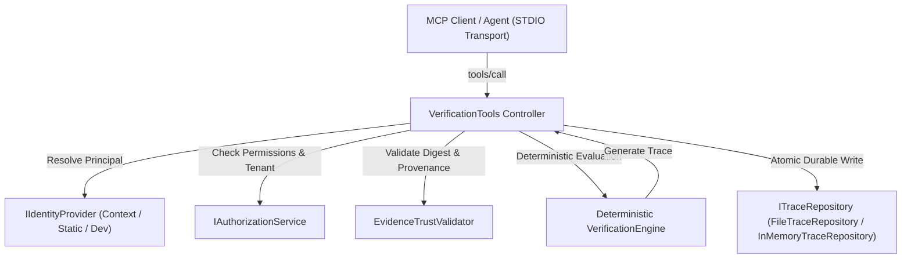

# AgentProof — Phase 5: Production Hardening, Trust, Persistence & Security

## 1. Executive Summary

Phase 5 transitions AgentProof from an in-memory MCP protocol demonstration into a hardened, production-ready, tenant-isolated verification layer. It addresses fundamental security, persistence, trust, and auditability requirements:

1. **Trusted Execution Identity & Authorization:** Replaces untrusted caller-asserted tenant IDs with an explicit `SecurityPrincipal` and `IIdentityProvider` context. Enforces least-privilege permission checks (`verify:execute`, `trace:read`, `trace:write`, `scenario:run`, `scenario:list`).
2. **Strict Tenant Isolation:** Enforces tenant boundaries at every access point (verification requests, repository reads/writes, trace inspection, and scenario runs). Prevents cross-tenant information leakage and cross-tenant resource contamination.
3. **Durable Verification Trace Storage:** Implements `ITraceRepository` and `FileTraceRepository` featuring disk persistence, tenant directory partitioning, write-once immutability, atomic temp-file write-ahead with rename, and SHA-256 envelope checksum verification. Preserves `InMemoryTraceRepository` for deterministic test suites.
4. **Evidence Provenance & Trust Classification:** Distinguishes payload integrity (cryptographic SHA-256 digest) from evidence authenticity (authenticated observer/source). Introduces explicit trust levels (`UNVERIFIED`, `INTEGRITY_CHECKED`, `SOURCE_AUTHENTICATED`, `ATTESTED`), anti-self-elevation guarantees, timestamp/clock-skew validation, and cryptographic attestation signature verification.
5. **Deterministic Tri-State Logic Preservation:** Integrates evidence trust validation directly into condition evaluation: untrusted or corrupted evidence produces `INCONCLUSIVE` (with `INC_UNTRUSTED_EVIDENCE`), never a false `PASS` or premature `FAIL`.
6. **Hardened MCP Tools:** Updates `verify_outcome`, `inspect_trace`, `run_scenario`, and `list_scenarios` with execution authorization, durable persistence, input bounds (maximum 50 postconditions, 100 evidence items), and fail-closed security.
7. **Comprehensive Automated Validation:** 26 passing test files (161 passing tests), zero TypeScript compilation errors, clean production bundle, and passing MCP STDIO protocol smoke test.

---

## 2. Implemented Architecture



### Components

- `src/security/`:
  - `identity.ts`: `SecurityPrincipal`, `IIdentityProvider`, `StaticIdentityProvider`, `ContextIdentityProvider`, `DefaultDevelopmentIdentityProvider`.
  - `authorization.ts`: `Permissions`, `IAuthorizationService`, `DefaultAuthorizationService`.
  - `errors.ts`: Typed security errors (`AuthenticationError`, `AuthorizationError`, `TenantAccessDeniedError`, `DuplicateTraceError`, `CorruptedRecordError`, `TraceNotFoundError`, `EvidenceTrustError`).
- `src/persistence/`:
  - `trace-repository.interface.ts`: `ITraceRepository` contract (`saveForTenant`, `getByTenantAndId`, `listByTenant`, `count`, `has`, `clear`, `close`).
  - `in-memory-trace-repository.ts`: Thread-safe, deep-cloned in-memory repository for unit tests.
  - `file-trace-repository.ts`: Tenant-partitioned filesystem persistence with atomic writes and SHA-256 envelope checksums.
- `src/core/verification/`:
  - `evidence-trust-validator.ts`: Canonical JSON serialization, SHA-256 computation, timestamp skew verification, cryptographic RSA attestation verification, and trust level derivation.
  - `condition-evaluator.ts`: Extended with untrusted/corrupted evidence detection (`INC_UNTRUSTED_EVIDENCE`).
- `src/config/`:
  - `index.ts`: Centralized, validated environment configuration (`AGENTPROOF_STORAGE_BACKEND`, `AGENTPROOF_STORAGE_DIR`, `AGENTPROOF_DEV_AUTH`, resource limits).

---

## 3. Running the Application & Tests

### Prerequisites
- Node.js >= 20.0.0
- npm >= 9.0.0

### Run Tests
```bash
# Run complete Vitest automated test suite (26 files, 161 tests)
npm test

# Run type check
npx tsc --noEmit
```

### Build Production Bundle
```bash
npm run build
```

### Run MCP Protocol Smoke Test
```bash
node scripts/protocol-smoke-test.mjs
```

### Configuration Options
| Variable | Default | Description |
|---|---|---|
| `AGENTPROOF_STORAGE_BACKEND` | `file` (prod) / `in-memory` (test) | Trace repository backend |
| `AGENTPROOF_STORAGE_DIR` | `.agentproof/data/traces` | Storage root directory for FileTraceRepository |
| `AGENTPROOF_DEV_AUTH` | `true` | Allows DefaultDevelopmentIdentityProvider in local development |

---

## 4. Known Limitations & Trust Boundaries

1. **STDIO Transport Authentication:** The standard Model Context Protocol (MCP) over STDIO does not include per-request HTTP headers or TLS client certificates natively. In production deployments, authentication context must be passed via execution environment context, signed tokens in the request metadata, or secure host process injection.
2. **Attestation Keys:** While cryptographic attestation signature verification is implemented and tested with standard RSA keys, production public keys must be provisioned via secure key management systems (KMS/HSM).
3. **Storage Engine:** Phase 5 implements filesystem-level durable persistence (`FileTraceRepository`) with atomic write-ahead and checksums, avoiding external database dependencies. Distributed clusters requiring multi-node coordination should implement an `ITraceRepository` adapter backed by an enterprise database (e.g., PostgreSQL).
